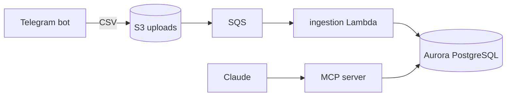

# draupnir

Personal finance tool for two users. Send a bank statement CSV to a Telegram bot; it is
imported into Aurora PostgreSQL, and Claude reads the accounts and transactions through a
remote MCP server.



Supported banks: SEB, Swedbank, Revolut, monobank, PrivatBank.

## Layout

| Path         | What                                                                    |
| ------------ | ----------------------------------------------------------------------- |
| `shared/`    | Database access, row-level security helpers, migrations, MCP data tools |
| `ingestion/` | Statement parsers and the import Lambda                                 |
| `bot/`       | Telegram bot Lambdas                                                    |
| `mcp/`       | MCP server and OAuth endpoints                                          |
| `infra/`     | Pulumi program for AWS                                                  |
| `openspec/`  | Specs (`specs/`) and changes (`changes/`)                               |
| `docs/`      | Architecture, data model, bot guide, ADRs                               |

## Develop

Needs Node.js 24 and pnpm.

```bash
pnpm install
pnpm exec nx run-many -t lint typecheck test build
pnpm exec nx format:write --all
```

Deploying and stack configuration: [infra/README.md](infra/README.md).
Rules for AI agents (and a good summary for people): [AGENTS.md](AGENTS.md).

## Docs

- [Architecture](docs/architecture.md)
- [Data model](docs/data-model.md)
- [Telegram bot](docs/telegram-bot.md)
- [Architecture decisions](docs/adr/)
