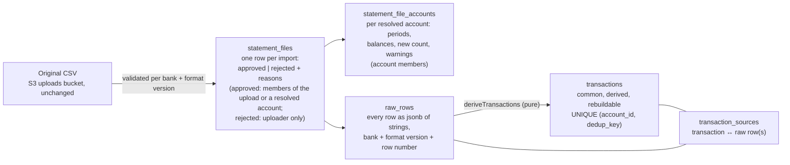

# AWS Architecture

High-level view of the resources provisioned by the Pulumi stack in `infra/` (see `infra/index.ts` and `infra/lib/*`). Supporting resources are omitted below for readability, including: IAM roles/policies and Lambda invoke permissions (one role per Lambda — note that `dataApiPolicyStatements` grants the same Data API actions, including transactions/batch writes, to every DB-backed route even though only `ingest` uses transactions), `ManagedLoginBranding`, the API Gateway `Deployment`/`Stage`, the RDS `SubnetGroup`, and the SQS queue policy/S3 bucket notification/Lambda event source mapping (shown only as the edges they wire up).

```mermaid
graph TB
  subgraph Auth["Cognito Auth (cognito.ts)"]
    UserPool["Cognito User Pool<br/>draupnir-users"]
    GoogleIdP["Google Identity Provider"]
    UserPoolClient["User Pool Client<br/>draupnir-app"]
    Domain["User Pool Domain<br/>Managed Login"]
    PreSignUpFn["λ pre-sign-up-trigger"]

    UserPool --> GoogleIdP
    UserPool --> UserPoolClient
    UserPool --> Domain
    UserPool -. invokes .-> PreSignUpFn
  end

  subgraph API["API Gateway (ingestionApi.ts)"]
    RestApi["REST API<br/>draupnir-ingestion (stage = stack)"]
    Authorizer["Cognito Authorizer"]
    WhoamiFn["λ whoami<br/>GET /whoami"]
    AccountsFn["λ accounts<br/>POST /accounts"]
    UploadFn["λ presigned-upload<br/>POST /uploads"]

    RestApi --> Authorizer
    RestApi --> WhoamiFn
    RestApi --> AccountsFn
    RestApi --> UploadFn
  end
  Authorizer -. validates JWT against .-> UserPool

  subgraph Ingestion["Ingestion Pipeline (ingestionPipeline.ts)"]
    UploadsBucket[("S3: uploads")]
    Queue["SQS: ingestion"]
    DLQ["SQS: ingestion-dlq"]
    IngestFn["λ ingest"]

    UploadsBucket -- "s3:ObjectCreated" --> Queue
    Queue -- "event source mapping" --> IngestFn
    Queue -. "maxReceiveCount 5" .-> DLQ
  end

  subgraph Data["Aurora (aurora.ts) — private VPC, no NAT/IGW"]
    VPC["VPC 10.0.0.0/16"]
    SubnetA["Subnet AZ-a"]
    SubnetB["Subnet AZ-b"]
    SG["Security Group<br/>(no ingress rules)"]
    Cluster["Aurora PostgreSQL 17.7<br/>Serverless v2, 0-1 ACU<br/>RDS Data API enabled"]
    Instance["DB Instance<br/>db.serverless"]
    Secret[("Secrets Manager<br/>master user password")]
    AppSecret[("Secrets Manager<br/>draupnir_app password<br/>(Pulumi RandomPassword)")]

    VPC --> SubnetA & SubnetB & SG
    SubnetA & SubnetB -- "DB subnet group" --> Cluster
    SG -- "vpcSecurityGroupIds" --> Cluster
    Cluster --> Instance
    Cluster -. "manageMasterUserPassword" .-> Secret
  end

  subgraph Migrations["Database Migrations (databaseMigrations.ts)"]
    MigrateFn["λ migrate-database<br/>no VPC, 5 min timeout"]
    MigrateInvocation["Pulumi Invocation<br/>re-runs when the bundle changes"]

    MigrateInvocation -- "invokes" --> MigrateFn
  end
  MigrateFn -- "RDS Data API<br/>schema_migrations + DDL<br/>(master credential)" --> Cluster
  MigrateFn -. "reads, sets role password" .-> AppSecret
  MigrateInvocation -. "dependsOn: schema before code" .-> IngestFn
  MigrateInvocation -. "dependsOn" .-> AccountsFn
  MigrateInvocation -. "dependsOn" .-> UploadFn

  subgraph Bot["Telegram bot (bot.ts, botQueues.ts)"]
    BotApi["API Gateway draupnir-bot<br/>no authorizer, throttled<br/>POST /webhook · GET /telegram/callback"]
    WebhookFn["λ bot-webhook<br/>secret header check, enqueue only"]
    CallbackFn["λ bot-callback<br/>finishes Google sign-in"]
    UpdatesQ["SQS FIFO: bot-updates<br/>group = chat, dedup = update_id"]
    OutcomesQ["SQS: bot-outcomes"]
    BotDlq["DLQs (updates, outcomes)"]
    WorkerFn["λ bot-worker<br/>no VPC"]
    RetentionFn["λ bot-retention<br/>every hour, no retries"]
    TelegramClient["Cognito client<br/>draupnir-telegram"]
    BotToken[("Secret: bot token<br/>(value stored by hand)")]
    WebhookSecret[("Secret: webhook<br/>secret header")]
    ClientSecret[("Secret: Cognito<br/>client secret")]

    BotApi --> WebhookFn
    BotApi --> CallbackFn
    WebhookFn -- "SendMessage" --> UpdatesQ
    UpdatesQ --> WorkerFn
    OutcomesQ --> WorkerFn
    UpdatesQ & OutcomesQ -. "after 3 / 5 deliveries" .-> BotDlq
    RetentionFn -- "republish missed outcomes" --> OutcomesQ
  end
  Telegram(["Telegram Bot API"]) -- "webhook" --> BotApi
  WorkerFn -- "send / delete messages" --> Telegram
  RetentionFn -- "delete old messages" --> Telegram
  UserPool --> TelegramClient
  CallbackFn -. "code exchange" .-> Domain
  WorkerFn -. "cognito-idp:ListUsers (/share)" .-> UserPool
  WorkerFn -- "s3:PutObject uploads/*" --> UploadsBucket
  WorkerFn -- "RDS Data API<br/>(draupnir_app)" --> Cluster
  CallbackFn -- "RDS Data API<br/>(draupnir_app)" --> Cluster
  RetentionFn -- "RDS Data API<br/>(draupnir_app)" --> Cluster
  IngestFn -- "publishes each outcome" --> OutcomesQ
  WebhookFn -. "read" .-> WebhookSecret
  CallbackFn -. "read" .-> BotToken
  CallbackFn -. "read" .-> ClientSecret
  WorkerFn -. "read" .-> BotToken
  RetentionFn -. "read" .-> BotToken
  MigrateInvocation -. "dependsOn" .-> CallbackFn
  MigrateInvocation -. "dependsOn" .-> WorkerFn
  MigrateInvocation -. "dependsOn" .-> RetentionFn

  UploadFn -. "presigns a PutObject URL for" .-> UploadsBucket
  UploadFn -- "RDS Data API<br/>(draupnir_app)" --> Cluster
  AccountsFn -- "RDS Data API<br/>(draupnir_app)" --> Cluster
  IngestFn -- "s3:GetObject" --> UploadsBucket
  IngestFn -- "RDS Data API<br/>(draupnir_app)" --> Cluster
  RebuildFn["λ rebuild-account<br/>manual invoke"] -- "RDS Data API<br/>(draupnir_app)" --> Cluster
```

## Notes

- **No direct network path to Aurora.** Every DB-backed Lambda talks to the cluster exclusively through the RDS Data API's HTTPS endpoint (ADR-0003) — the security group has no ingress rules, and the VPC has no NAT/internet gateway.
- **Aurora scales to zero** (`minCapacity: 0`, `secondsUntilAutoPause: 300`) — near-zero idle cost, at the price of a resume delay (seconds to ~1 minute) on the first request after idle. DB-backed API routes are given a 29s timeout (API Gateway's ceiling without a quota increase) to absorb this.
- **`whoami`** is the one API route that doesn't touch Aurora or S3 — no DB/bucket environment variables, no extra IAM policy statements beyond basic Lambda execution.
- **Schema before code.** `pulumi up` invokes `migrate-database` (the runner in `shared/src/lib/migrations`) before any DB-backed Lambda is created or updated; a failed migration fails the deploy. The Invocation re-runs when the migration bundle changes (it hashes the esbuild output, which inlines `MIGRATIONS`); the runner is idempotent, so a re-run with nothing pending is a no-op. Migrations are append-only — see the `db-migrations` spec.
- **Two database credentials, and row-level security.** The master credential (AWS-managed secret) is read only by `migrate-database`; it owns the tables and so bypasses RLS. Every other Lambda uses the `draupnir_app` credential (a Pulumi-generated password in its own secret): that role owns nothing and has no `BYPASSRLS`. The runner creates the role and re-syncs its password from the secret on every run, before applying migrations. Policies on every account-scoped table check membership through `draupnir.is_member()`, which reads the caller from `app.sub`. Application code sets it per transaction with `withCaller(sub, fn)` (`set_config(..., true)`, so it can't leak across Data API's pooled sessions); with no identity set, every policy returns no rows. A new table must ship with policies — a guard test in `shared` fails otherwise.
- **Rebuild is manual.** `rebuild-account` (no trigger, no HTTP route) re-derives one account's transactions from its raw rows: `aws lambda invoke --function-name <rebuildAccountFunctionName> --payload '{"sub":"<owner sub>","accountId":"<id>"}' --cli-binary-format raw-in-base64-out out.json`. With `"mode":"backfill"` in the payload it instead fills an existing account's order keys, running balances and balance in place without replacing rows ([ADR-0013](./adr/0013-stored-account-balances.md)).
- **Telegram flow.** The public webhook only checks Telegram's secret header and enqueues (it never touches the database). The worker handles each update as the linked user (`withCaller`), and statement outcomes reach the chat through a transactional outbox: ingestion writes the outcome row in the same transaction that commits the file, publishes it to `bot-outcomes`, and the retention Lambda's schedule republishes any that were missed or that the queue gave up on. Messages the bot sends in a linked chat are recorded and deleted after 24 hours; the uploaded CSV message is deleted right after the report.
- **Interface.** Telegram bot only, no web app; Google/Cognito stays the identity and Telegram is a linked channel (ADR-0009); setup and user guide in [telegram-bot.md](./telegram-bot.md).
- Deletion protection + a final snapshot are enabled on the Aurora cluster since it holds live account/transaction data.

## Statement storage model

Every table, column and function is described in [data-model.md](./data-model.md), which a test keeps in step with the migrations.

Three layers (ADR-0008); access is by account membership (`account_members`, role `owner` | `viewer`), and every account-scoped table carries its own `account_id`.

- **Import** = validate → (one DB transaction: lock accounts in id order → duplicate-file, overlap and continuity checks → write file, per-account records, raw rows, transactions, sources). A validation failure is committed as a `rejected` file with reasons and acknowledged; only unexpected errors retry and reach the DLQ.
- **Raw rows are authoritative.** Overlapping statements keep one raw row each and share one transaction through `transaction_sources`. `rebuild-account` re-derives an account's transactions from its raw rows after a normalization fix, with no re-upload.
- **Warnings, not rejections, for gaps.** Continuity comes from balances or declared periods, never from days without activity; see `ingestion/src/lib/validation/coverage.ts`.

See the ADRs in `docs/adr/` for the reasoning behind these choices, and `infra/lib/*.ts` for the resource definitions.
